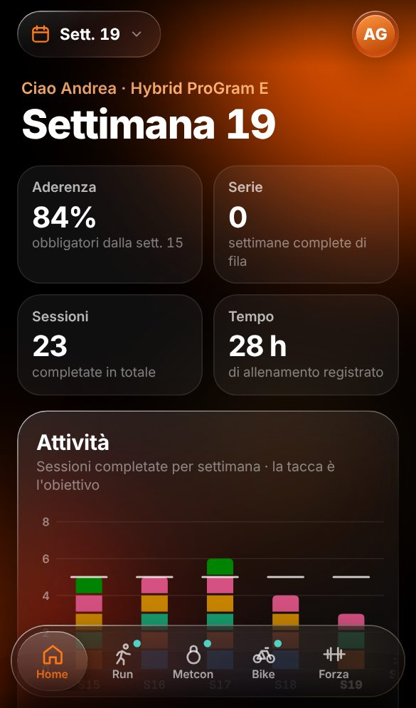
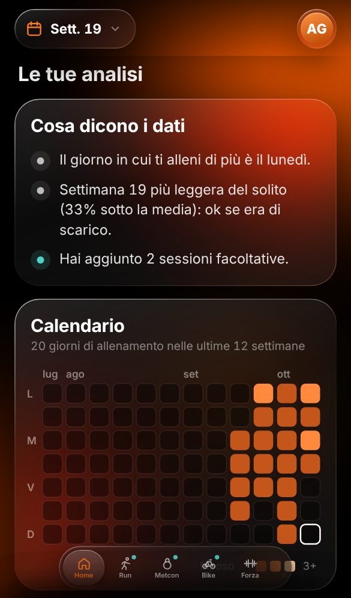
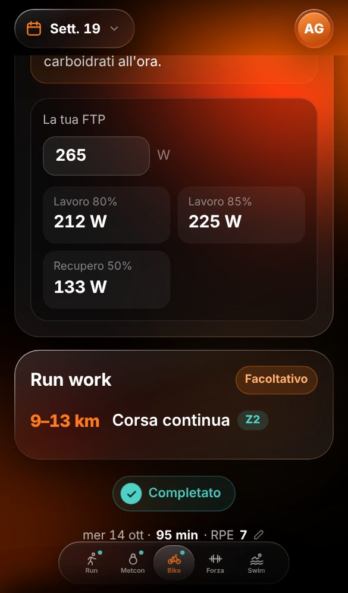
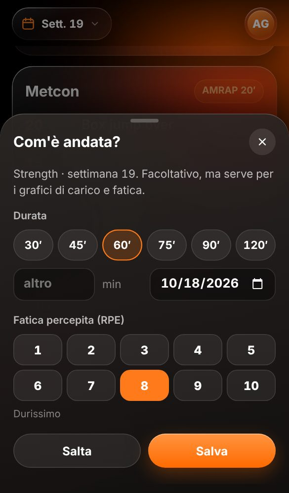
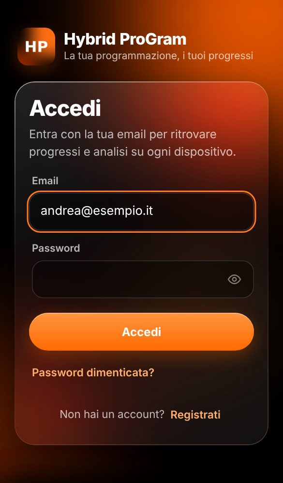
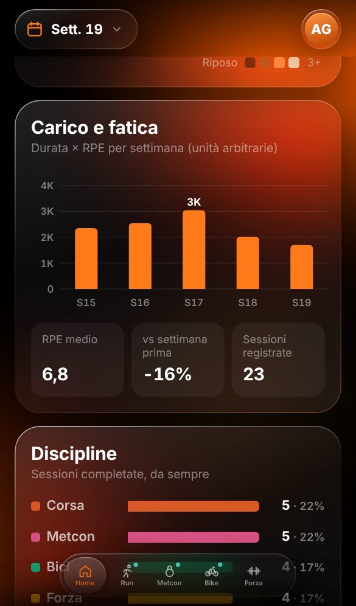
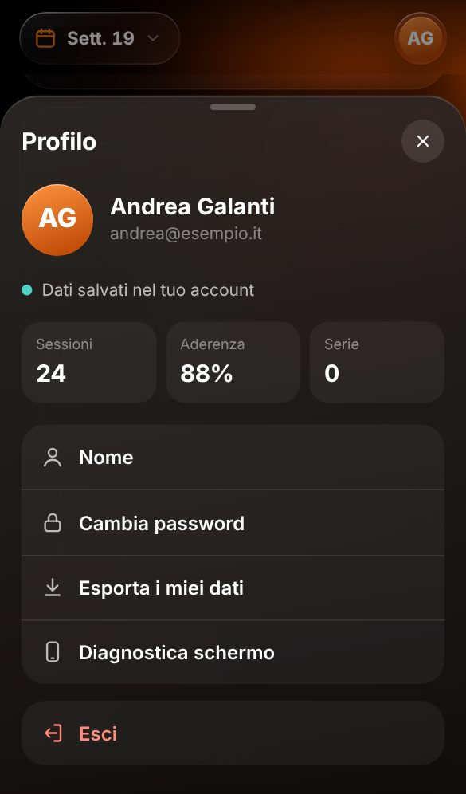
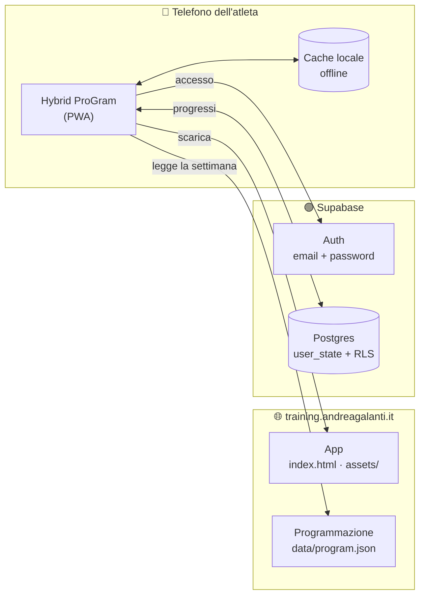
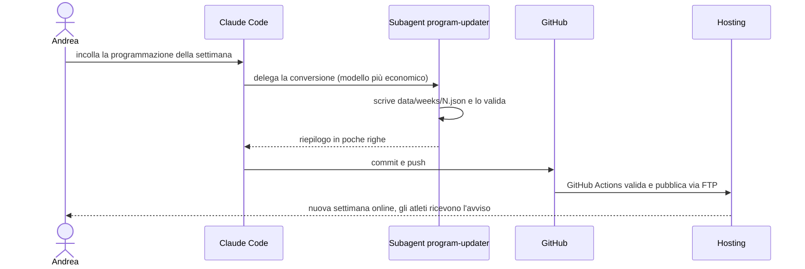

<div align="center">


# Hybrid ProGram

**La programmazione settimanale di allenamento ibrido, sempre in tasca.**<br>
Corsa, bici, nuoto, forza e metcon in un'unica web app, con i progressi di ogni atleta salvati nel suo account.

[](https://training.andreagalanti.it)

[](https://github.com/andreagalanti91/training/actions/workflows/deploy.yml)


</div>

<br>

<p align="center">
  
  &nbsp;
  
  &nbsp;
  
  &nbsp;
  
</p>

---

## Indice

- [Cosa fa](#-cosa-fa)
- [Schermate](#-schermate)
- [Come funziona](#-come-funziona)
- [Aggiornare la programmazione ogni settimana](#-aggiornare-la-programmazione-ogni-settimana)
- [I dati degli atleti](#-i-dati-degli-atleti)
- [Struttura del progetto](#-struttura-del-progetto)
- [Installazione e configurazione](#-installazione-e-configurazione)
- [Pubblicazione](#-pubblicazione)
- [Sviluppo e test](#-sviluppo-e-test)
- [Risoluzione problemi](#-risoluzione-problemi)

---

## ✨ Cosa fa

| | |
|---|---|
| 🔐 **Account con email** | Registrazione e accesso solo con email e password. Conferma via email, recupero password, cambio password dal profilo. |
| 💾 **Progressi al sicuro** | Sessioni fatte, durata, fatica (RPE), valori dei calcolatori e preferenze sono salvati nell'account. Restano identici quando si aggiorna l'app o la programmazione e si ritrovano su ogni dispositivo. |
| 📊 **Home con analisi** | Aderenza agli obbligatori, settimane complete di fila, sessioni e ore totali, grafico attività per disciplina, calendario degli allenamenti, carico settimanale (durata × RPE), ripartizione per disciplina e analisi scritte automatiche. |
| 🏋️ **Schede allenamento** | Una scheda per sessione con zone colorate, livelli (Élite / Scaled / Beginner), carichi Rx e Scaled e confronto con la settimana precedente. |
| 🧮 **Calcolatori personali** | Passi dalle ripetute, % FTP e % massimali calcolati sui valori dell'atleta, salvati e riproposti ogni settimana. |
| 📝 **Registro sessione** | Segnando un allenamento come fatto si possono aggiungere giorno, durata ed RPE (facoltativo). |
| 👤 **Profilo** | In alto a destra: guida *Salva il sito come app* (iPhone e Android, con installazione diretta su Chrome), nome, stato della sincronizzazione, cambio password, esportazione dei dati in JSON, uscita. |
| 📱 **App installabile** | Si aggiunge alla schermata Home di iPhone e Android, funziona anche offline e si aggiorna da sola. |

---

## 📸 Schermate

<table>
  <tr>
    <td align="center"><br><sub><b>Accesso</b><br>solo email e password</sub></td>
    <td align="center"><br><sub><b>Home</b><br>indicatori e attività per settimana</sub></td>
    <td align="center"><br><sub><b>Analisi</b><br>insight automatici e calendario</sub></td>
  </tr>
  <tr>
    <td align="center"><br><sub><b>Carico e discipline</b><br>durata × RPE, ripartizione</sub></td>
    <td align="center"><br><sub><b>Allenamento</b><br>calcolatori su FTP e passi</sub></td>
    <td align="center"><br><sub><b>Com'è andata?</b><br>durata e fatica percepita</sub></td>
  </tr>
  <tr>
    <td align="center"><br><sub><b>Profilo</b><br>sincronizzazione ed esportazione</sub></td>
    <td></td>
    <td></td>
  </tr>
</table>

<sub>Le schermate si rigenerano con `node tests/screenshots.mjs` usando un account dimostrativo.</sub>

---

## 🧭 Come funziona

L'app è un sito statico (HTML, CSS e JavaScript senza build) pubblicato sull'hosting di
`training.andreagalanti.it`. Programmazione e dati degli atleti viaggiano su strade separate:
per questo aggiornare l'una non tocca mai gli altri.



- **Programmazione**: uguale per tutti, sta in `data/program.json` ed è generata dai file in `data/weeks/`.
- **Account**: Supabase Auth, solo provider email.
- **Dati atleta**: una riga per utente nella tabella `user_state`, protetta da Row Level Security:
  ogni utente legge e scrive solo i propri dati.
- **Offline**: il service worker conserva app e programmazione; le modifiche fatte senza rete
  partono appena la connessione torna.

---

## 🗓️ Aggiornare la programmazione ogni settimana

Il flusso pensato per l'uso quotidiano: si incolla il testo del coach in una sessione di
Claude Code e il resto è automatico.



1. Incolla la programmazione così come la ricevi, anche testo libero.
2. Il subagent [`program-updater`](.claude/agents/program-updater.md) legge solo l'ultima settimana come modello,
   scrive `data/weeks/<N>.json`, riusa gli `id` delle sessioni e le chiavi dei calcolatori, poi valida tutto.
3. Claude controlla il riepilogo, fa commit e push: il workflow pubblica la nuova settimana.
4. All'apertura dell'app gli atleti vedono *“Nuova programmazione: settimana N”*.

A mano si fa così:

```bash
# 1. crea o modifica la settimana
$EDITOR data/weeks/20.json
# 2. valida e rigenera data/program.json
npm run build
```

Il formato completo, con esempi per righe, livelli, tabelle, carichi e calcolatori, è in
[`docs/PROGRAM_FORMAT.md`](docs/PROGRAM_FORMAT.md).

> [!IMPORTANT]
> L'`id` di una sessione (`run`, `metcon`, `bike`, `forza`, `swim`, `row`…) non va mai cambiato:
> i progressi degli atleti sono legati a `settimana + id`. Titolo, ordine e contenuti invece si possono modificare liberamente.

---

## 🔒 I dati degli atleti

| Cosa viene salvato | Dove |
|---|---|
| Sessioni completate, con giorno, durata ed RPE | `user_state.state.done` |
| Valori dei calcolatori (passo 10 km, FTP, massimali…) | `user_state.state.inputs` |
| Livello scelto, settimana aperta | `user_state.state.prefs` |
| Nome | `user_state.state.profile` |

- **Fusione voce per voce**: ogni voce ha il suo orario di modifica. Unendo telefono, tablet e
  server vince la modifica più recente di ciascuna voce, quindi non si perde nulla.
- **Vecchia versione**: al primo accesso le spunte e i valori salvati sul dispositivo dalla
  versione precedente dell'app vengono importati nell'account.
- **Esportazione**: ogni atleta scarica i propri dati da *Profilo → Esporta i miei dati*.
- **Sicurezza**: nel sito c'è solo la chiave *publishable* di Supabase, pubblica per design.
  Le regole RLS in [`supabase/schema.sql`](supabase/schema.sql) impediscono a chiunque di leggere i dati altrui.

---

## 📁 Struttura del progetto

```text
training/
├── index.html                 Pagina dell'app
├── sw.js                      Service worker (offline e aggiornamenti)
├── manifest.webmanifest       Installazione come app
├── .htaccess                  Cache e sicurezza per l'hosting Apache
├── assets/
│   ├── app.js                 Routing, schermate, accesso, profilo
│   ├── api.js                 Client Supabase via REST (auth + user_state)
│   ├── store.js               Stato dell'atleta, fusione, cache e sincronizzazione
│   ├── charts.js              Analisi e grafici SVG della Home
│   ├── app.css                Stile "liquid glass"
│   └── config.js              URL e chiave publishable di Supabase
├── data/
│   ├── weeks/<N>.json         Programmazione, un file per settimana (sorgente)
│   └── program.json           File generato letto dall'app
├── scripts/build-program.mjs  Validazione e generazione di program.json
├── supabase/schema.sql        Tabella user_state e regole di accesso
├── tests/                     Test end-to-end e Supabase simulato
├── docs/                      Setup, formato della programmazione, schermate
├── .claude/agents/            Subagent per gli aggiornamenti settimanali
└── .github/workflows/         Validazione e pubblicazione automatica
```

---

## ⚙️ Installazione e configurazione

La guida passo passo è in [`docs/SETUP.md`](docs/SETUP.md). In breve:

1. **Supabase**: crea il progetto ed esegui [`supabase/schema.sql`](supabase/schema.sql) nel *SQL Editor*.
2. **Autenticazione**: lascia attivo solo il provider *Email*, con la conferma email.
   In *URL Configuration* imposta come Site URL `https://training.andreagalanti.it`
   e aggiungi `https://training.andreagalanti.it/**` ai Redirect URL.
3. **Collega l'app**: inserisci *Project URL* e chiave *publishable* in [`assets/config.js`](assets/config.js).
4. **Email** (consigliato): traduci i modelli *Confirm signup* e *Reset password* e configura un SMTP tuo:
   quello integrato di Supabase invia poche email l'ora.

---

## 🚀 Pubblicazione

Ogni push sul branch di pubblicazione avvia [`deploy.yml`](.github/workflows/deploy.yml), che:

1. valida tutta la programmazione;
2. controlla che `data/program.json` sia rigenerato;
3. trova da solo la cartella del sito sul server FTP;
4. carica solo i file dell'app (niente test, documentazione o sorgenti);
5. verifica che la nuova versione risponda online.

Per attivarlo aggiungi i secret del repository in
*Settings → Secrets and variables → Actions*:

| Secret | Esempio | Obbligatorio |
|---|---|:---:|
| `FTP_SERVER` | `ftp.andreagalanti.it` | ✅ |
| `FTP_USERNAME` | nome utente FTP | ✅ |
| `FTP_PASSWORD` | password FTP | ✅ |
| `FTP_DIR` | `training.andreagalanti.it/` | — |

> [!CAUTION]
> Il repository è pubblico: le credenziali vanno **solo** nei secret, mai nei file.

Pubblicazione manuale: carica `index.html`, `sw.js`, `manifest.webmanifest`, `.htaccess`, le icone,
la cartella `assets/` e `data/program.json` nella cartella del sito.

---

## 🧪 Sviluppo e test

Serve solo Node.js 22 (e Playwright per i test end-to-end).

```bash
npm run dev     # app + Supabase simulato su http://localhost:8787
npm run check   # valida la programmazione
npm run build   # valida e rigenera data/program.json
npm test        # validazione + test end-to-end su iPhone simulato
```

I test end-to-end ([`tests/e2e.mjs`](tests/e2e.mjs)) coprono:

- registrazione, validazioni, accesso, errore password, uscita;
- salvataggio sul server e ritrovamento su un secondo dispositivo;
- programmazione riordinata con i progressi che restano sulla sessione giusta;
- sessione scaduta, link di recupero password, link scaduto;
- import dei dati della vecchia versione;
- altezza a tutto schermo e navbar in basso, anche da app installata su iOS;
- grafici, tooltip e assenza di errori JavaScript.

Dopo una modifica al codice aggiorna il numero `?v=` in `index.html` e la `CACHE` in `sw.js`,
così i telefoni scaricano subito la nuova versione.

---

## 🛟 Risoluzione problemi

<details>
<summary><b>Il link di conferma o di recupero password porta alla pagina sbagliata</b></summary>

In Supabase → *Authentication → URL Configuration* controlla Site URL
(`https://training.andreagalanti.it`) e Redirect URL (`https://training.andreagalanti.it/**`).
</details>

<details>
<summary><b>Le email di conferma non arrivano</b></summary>

Controlla lo spam. Il servizio email integrato di Supabase ha limiti molto bassi: configura un SMTP
in *Authentication → Emails → SMTP Settings*. Dalla schermata *Controlla l'email* l'atleta può farsi rimandare il link.
</details>

<details>
<summary><b>Il pallino accanto al profilo è grigio o rosso</b></summary>

Grigio vuol dire offline: le modifiche restano sul telefono e partono appena torna la rete.
Rosso vuol dire errore di sincronizzazione: l'app riprova da sola; se persiste verifica che la
tabella `user_state` esista (*Table Editor*) e riesegui `supabase/schema.sql`.
</details>

<details>
<summary><b>Sull'iPhone c'è uno spazio vuoto sotto la navbar</b></summary>

Apri *Profilo → Diagnostica schermo* e manda una foto dei valori: indicano come iOS sta misurando lo schermo.
</details>

<details>
<summary><b>Dopo un aggiornamento vedo ancora la versione vecchia</b></summary>

Chiudi e riapri l'app: il service worker scarica la nuova versione all'avvio. Se pubblichi a mano,
verifica di aver aggiornato `?v=` in `index.html` e `CACHE` in `sw.js`.
</details>

---

<div align="center">
<sub>Hybrid ProGram · programmazione di <a href="https://training.andreagalanti.it">Andrea Galanti</a></sub>
</div>
